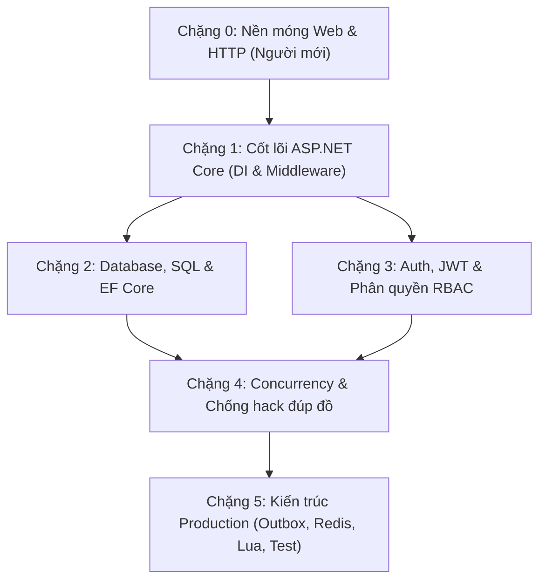

# 🗺️ Lộ Trình Học Backend Từ Zero → Production (Dựa Trên Chính `LearnBackend`)

Mỗi bài học gắn trực tiếp với **file code thật** trong dự án này — học lý thuyết 5 phút, mở code xem ngay 5 phút, thử thực hành 5 phút!

---

## Chặng 0: Nền móng Web & HTTP (Cho người mới bắt đầu)
*Mục tiêu: Hiểu thực sự "Backend" đang làm gì mỗi khi Unity/Trình duyệt bấm 1 nút.*

- **Bài 0.1 — Client & Server nói chuyện thế nào? (HTTP, URL, Method GET/POST, JSON)**
  - File thực tế: `Modules/MasterData/MasterDataController.cs`, `LearnBackend.http`
  - Thực hành: Chạy `dotnet run`, gọi thử `GET /api/master-data` và đọc JSON trả về.
- **Bài 0.2 — Mã trạng thái HTTP (Status Code) & Format trả về chuẩn (`ApiResponse<T>`)**
  - Hiểu rõ khi nào dùng `200`, `400`, `401`, `403`, `404`, `409`, `429`, `500`, `503`.
  - File thực tế: `LearnBackend.Shared/Contracts/ApiResponse.cs`, `GameErrorCodes.cs`
- **Bài 0.3 — Tại sao game không được tin Client? (Server-Authoritative)**
  - Hiểu lý do tiền, máu, sát thương, quay Gacha phải tính trên Server thay vì Unity.
  - File thực tế: `Modules/Battle/BattleService.cs`, `Modules/Gacha/GachaRoller.cs`

---

## Chặng 1: Cốt lõi ASP.NET Core (.NET Backend)
*Mục tiêu: Đọc hiểu `Program.cs` từ dòng đầu tới dòng cuối, hiểu luồng đi của 1 request.*

- **Bài 1.1 — Dependency Injection (DI): `Singleton` vs `Scoped` vs `Transient`**
  - Vì sao `GameDbContext` phải là `Scoped`, còn `MasterDataStore` là `Singleton`? Nhầm thì nổ lỗi gì?
  - File thực tế: `Infrastructure/DependencyInjection/ServiceCollectionExtensions.cs`
- **Bài 1.2 — Middleware Pipeline ("Mô hình củ hành tây") & Thứ tự sống còn**
  - 1 request đi qua 7 lớp middleware như thế nào? Vì sao `CorrelationId` phải đứng đầu, `UseAuthentication` phải đứng trước `PlayerLockMiddleware`?
  - File thực tế: `Program.cs`, `Common/Middleware/CorrelationIdMiddleware.cs`, `ExceptionHandlingMiddleware.cs`
- **Bài 1.3 — `async` / `await` & `CancellationToken` trong Backend**
  - Vì sao backend phải dùng `async/await`? Điều gì xảy ra nếu 1.000 người gọi API mà bạn dùng `.Result` (chặn thread)?
  - File thực tế: `Modules/Player/PlayerService.cs`

---

## Chặng 2: Database, SQL & Entity Framework Core
*Mục tiêu: Thiết kế bảng không mất dữ liệu, query nhanh, hiểu ACID & Rich Domain.*

- **Bài 2.1 — Thiết kế bảng, Khóa chính (PK), Khóa ngoại (FK) & `CHECK` Constraint**
  - Vì sao `PlayerHeroes` gắn FK tới `Players` (`OnDelete.Cascade`), còn `CurrencyLedgers` cố tình **không** gắn FK?
  - File thực tế: `Infrastructure/Persistence/GameDbContext.cs`, `LearnBackend.Tests/DatabaseConstraintTests.cs`
- **Bài 2.2 — Index là gì? Vì sao truy vấn chậm thành nhanh gấp 1000 lần?**
  - Hiểu `Unique Index` (chống trùng username/nhận quà 2 lần) và `Composite Index` (`(PlayerId, CreatedAtUtc)`).
  - File thực tế: `Infrastructure/Persistence/GameDbContext.cs`
- **Bài 2.3 — Transaction (ACID) & Kế toán ví tiền (`CurrencyLedger` + Rich Domain)**
  - Tại sao trừ Gems và tặng Hero phải nằm trong **1 Transaction**? Tại sao `PlayerProfile.Gold` phải để `private set`?
  - File thực tế: `Modules/Player/Entities/PlayerProfile.cs`, `Modules/Gacha/GachaService.cs`
- **Bài 2.4 — Tránh bẫy N+1 Query & `AsNoTracking()` trong EF Core**
  - Khi nào thêm `.AsNoTracking()` để đọc nhanh gấp đôi? Cách gom dữ liệu không bị query lặp trong vòng `for`.
  - File thực tế: `Modules/Guild/GuildService.cs`, `Modules/Hero/HeroService.cs`

---

## Chặng 3: Auth, Security & Phân quyền (RBAC)
*Mục tiêu: Hiểu trọn vòng đời đăng nhập game hiện đại, không để lộ mật khẩu hay lọt API Admin.*

- **Bài 3.1 — Lưu mật khẩu an toàn (Hashing + Salt vs Encryption)**
  - Tại sao không bao giờ lưu mật khẩu thô và cũng không dùng mã hóa 2 chiều?
  - File thực tế: `Infrastructure/Security/PasswordHasher.cs`
- **Bài 3.2 — JWT Access Token & Refresh Token Rotation**
  - Bên trong chuỗi JWT có gì? Tại sao Access Token chỉ sống 60 phút, còn Refresh Token dùng xong phải hủy ngay?
  - File thực tế: `Infrastructure/Security/JwtTokenGenerator.cs`, `Modules/Auth/AuthService.cs`
- **Bài 3.3 — Guest `DeviceId` Login, Account Linking & RBAC (`401` vs `403`)**
  - Luồng "Chơi ngay không cần đăng ký" của game mobile (kiểu Nakama) và cách phân biệt `401 Unauthorized` vs `403 Forbidden`.
  - File thực tế: `Modules/Auth/AuthService.cs`, `Modules/LiveOps/LiveOpsController.cs`

---

## Chặng 4: Concurrency — Trị Race Condition & Lỗi Đúp Đồ
*Mục tiêu: Làm chủ bài toán khó nhất & hay bị hỏi nhất khi phỏng vấn Backend.*

- **Bài 4.1 — Race Condition & Pessimistic Lock (`PlayerLockMiddleware`)**
  - Phân tích lỗi bấm đúp hack Gems và cách `SemaphoreSlim` / Redis Lock bắt các request của cùng 1 người chơi phải xếp hàng.
  - File thực tế: `Common/Middleware/PlayerLockMiddleware.cs`, `Common/Locking/InMemoryPlayerLockManager.cs`
- **Bài 4.2 — Optimistic Concurrency (`WalletVersion` & `BossVersion`)**
  - Khi 20 người cùng đánh 1 Guild Boss thì không thể khóa từng người — giải quyết bằng `Version` + retry thế nào?
  - File thực tế: `Modules/Guild/GuildService.cs`, `LearnBackend.Tests/DatabaseConstraintTests.cs`
- **Bài 4.3 — Idempotency Key (Chống trừ tiền 2 lần khi mạng 4G lag)**
  - Phân biệt rõ **Lock** (chạy đồng thời) vs **Idempotency** (mạng lag gửi lại request cũ).
  - File thực tế: `Common/Middleware/IdempotencyMiddleware.cs`

---

## Chặng 5: Kiến Trúc Production & Scale Đa Server
*Mục tiêu: Tư duy như kỹ sư Backend thực thụ, hiểu hệ thống chịu tải hàng chục nghìn người.*

- **Bài 5.1 — Modular Monolith, Event Bus & Architecture Fitness Tests**
  - Vì sao `Auth` không gọi thẳng `Hero` mà bắn `PlayerRegisteredEvent`? Cách dùng Reflection tự động chặn code vi phạm kiến trúc.
  - File thực tế: `Common/Events/InProcessGameEventBus.cs`, `Modules/Hero/RpgStarterPackHandler.cs`, `LearnBackend.Tests/ArchitectureTests.cs`
- **Bài 5.2 — Transactional Outbox Pattern & `BackgroundService` (`PeriodicTimer`)**
  - Tại sao ghi bảng `OutboxMessages` trong cùng transaction giúp không bao giờ mất thông báo ngay cả khi server sập?
  - File thực tế: `Infrastructure/Outbox/OutboxMessage.cs`, `OutboxProcessorWorker.cs`
- **Bài 5.3 — Scale từ 1 Server lên nhiều Server (Redis, SignalR Backplane, Lua VM Pool)**
  - Những gì nằm trong RAM sẽ vỡ khi chạy 3 server, và cách Redis + Object Pool giải quyết.
  - File thực tế: `Infrastructure/Redis/`, `Hubs/GameHub.cs`, `Modules/Battle/Engine/LuaSkillRunner.cs`
